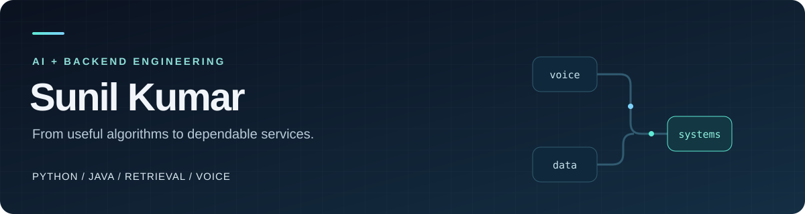

  <a href="https://www.linkedin.com/in/sunil-kumar12/">LinkedIn</a> ·
  <a href="https://github.com/sunilkumar123ss?tab=repositories">Projects</a>

### Hi, I'm Sunil

I work with **Python and Java** to build backend services and AI applications. My interests are retrieval, voice interfaces, and systems whose behavior you can inspect and test.

Based in **Noida, India** · Open to AI engineering and backend opportunities.

### Languages & tools

| Area | Toolkit |
| --- | --- |
| Languages | Python · Java · SQL |
| Backend | FastAPI · Spring Boot · REST APIs · SQLite |
| AI & retrieval | LangChain / LangGraph · Sentence-Transformers · Qdrant · MCP |
| Delivery | Docker · GitHub Actions · GitLab CI · Unit testing |

### A detail I built into RagKit

An answer should lead back to something you can check. In [**RagKit**](https://github.com/sunilkumar123ss/RagKit), each citation opens the original document at the **exact highlighted passage**, with offsets that stay correct for Unicode text.

The workspace combines keyword and semantic retrieval, cross-encoder reranking, persistent document storage, and MCP tools. It also works locally with cited source excerpts, without an API key.

### More work

| Project | What it explores |
| --- | --- |
| [VoiceDesk](https://github.com/sunilkumar123ss/VoiceDesk) | Conversation state, interruption handling, and keeping stale voice replies out of a session. |
| [DataTalk](https://github.com/sunilkumar123ss/DataTalk) | Constrained question-to-SQL with read-only SQLite access and execution limits. |
